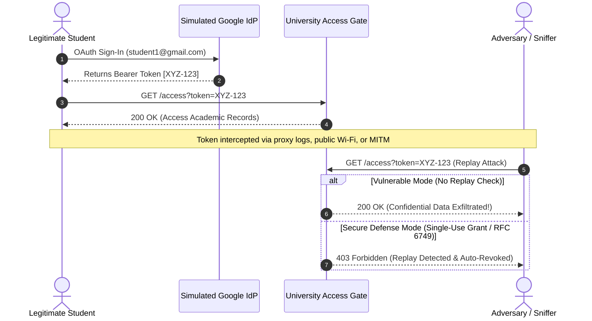

# OAuth Token Replay Attack Simulation

[](https://www.python.org/)
[](https://flask.palletsprojects.com/)
[](LICENSE)
[](https://joker-53.github.io/Auth-Simulation/)

An interactive cybersecurity laboratory simulating an **OAuth token replay vulnerability** in a university authentication system. This project demonstrates how reusable bearer tokens allow adversaries to hijack user sessions without credentials, and provides hands-on mechanics for verifying modern mitigation techniques (such as single-use token grants under RFC 6749 &sect;4.1.2, device/IP binding, and automatic token revocation).

---

## Live Interactive Demo

Try the zero-dependency browser version deployed on GitHub Pages:
**[https://joker-53.github.io/Auth-Simulation/](https://joker-53.github.io/Auth-Simulation/)**

---

## Vulnerability Background

OAuth 2.0 bearer tokens grant access to protected resources to whoever holds them. If a service does not enforce **single-use token grants**, **strict short-lived expiration (TTL)**, or **sender-constrained tokens (DPoP / mTLS)**, an intercepted token can be replayed repeatedly:



---

## Features

- **Simulated Google OAuth Provider**: Sign in with pre-configured student or faculty test accounts.
- **Vulnerable vs. Secure Modes**: Toggle live between unrestricted token reuse and single-use token enforcement.
- **Interactive Attacker Console (`/replay`)**: Submit intercepted tokens from arbitrary simulated IP addresses to observe access gate responses in real time.
- **Protected Resource Gate (`/access`)**: Validates token existence, TTL, client binding, and prior consumption. Supports query parameter (`?token=`) and standard HTTP `Authorization: Bearer <token>` headers.
- **Live Token Inspector & Security Audit Trail (`/admin/tokens`)**: Inspect active tokens, usage counts, revocations, and timestamped forensic logs.
- **Automated Test Suite**: 100% test coverage for simulation mechanics, attack vectors, and API endpoints using `pytest`.
- **Docker Support**: Containerized for instant, deterministic deployment.

---

## Project Structure

```text
Auth-Simulation/
├── .github/
│   └── workflows/
│       ├── test.yml            # Automated CI test suite
│       └── static.yml          # GitHub Pages deployment workflow
├── app/                        # Modular Flask application
│   ├── __init__.py             # Application factory (create_app)
│   ├── config.py               # Configuration & environment loader
│   ├── routes.py               # Application routes & API endpoints
│   ├── simulation.py           # Core OAuth token engine & replay defense
│   ├── static/
│   │   ├── css/style.css       # Responsive cybersecurity dashboard styling
│   │   └── js/simulation.js    # Client-side copy and helper utilities
│   └── templates/              # Jinja2 templates
│       ├── base.html           # Base layout with mode switcher & navbar
│       ├── index.html          # Interactive home with architecture flow
│       ├── login.html          # Simulated OAuth login with test accounts
│       ├── dashboard.html      # User portal & active token manager
│       ├── access.html         # Protected resource display (academic data)
│       ├── replay.html         # Attacker replay execution console
│       └── admin_tokens.html   # Real-time token registry & audit logs
├── docs/                       # Standalone browser demo for GitHub Pages
│   └── index.html              # Pure HTML/JS client-side simulator
├── tests/                      # Automated test suite
│   ├── conftest.py             # Pytest fixtures and test clients
│   ├── test_routes.py          # Route & integration tests
│   └── test_simulation.py      # Unit tests for token engine
├── .env.example                # Sample environment configuration
├── .gitignore                  # Python, pytest, and IDE ignore patterns
├── Dockerfile                  # Production container definition
├── docker-compose.yml          # One-command container launcher
├── LICENSE                     # MIT License
├── pytest.ini                  # Pytest configuration
├── requirements.txt            # Pinned dependencies
└── app.py                      # Main entrypoint script
```

---

## Setup Instructions

### Option 1: Local Python Environment

1. **Clone the repository**:
   ```bash
   git clone https://github.com/JOKER-53/Auth-Simulation.git
   cd Auth-Simulation
   ```

2. **Create and activate a virtual environment**:
   ```bash
   python3 -m venv venv
   source venv/bin/activate
   ```

3. **Install dependencies**:
   ```bash
   pip install -r requirements.txt
   ```

4. **Run the application**:
   ```bash
   python app.py
   ```
   Open [http://localhost:5000](http://localhost:5000) in your browser.

---

### Option 2: Docker / Docker Compose

Run with a single command:
```bash
docker compose up --build
```
Access the application at [http://localhost:5000](http://localhost:5000).

---

## Reproduction & Verification Guide

### Step 1: Legitimate Authentication
1. Navigate to `/login`.
2. Select **Student One** (`student1@gmail.com`) and click **Sign In**.
3. You will be redirected to `/dashboard`. Copy your active **Bearer Token**.

### Step 2: Access Protected Resources
1. Click **Access Protected Resource** or open:
   ```text
   http://localhost:5000/access?token=<YOUR_TOKEN>
   ```
2. You will observe the student's confidential GPA, academic standing, and records.

### Step 3: Execute a Replay Attack
1. Navigate to `/replay`.
2. Paste the intercepted token and provide an adversary IP (e.g. `198.51.100.77`).
3. Click **Execute Replay Attack Against /access**.
4. **Vulnerable Mode Result**: The attack succeeds with `200 OK`—the attacker exfiltrates the student's data.

### Step 4: Test Defense Mitigation
1. Click **Toggle Security Mode** in the navbar to switch to **Secure Mode**.
2. Generate a new token by logging in again at `/login`.
3. Consume the token once at `/access?token=<NEW_TOKEN>`.
4. Replay the same token at `/replay`.
5. **Secure Mode Result**: The attack is blocked with `403 Forbidden` (`Replay Attack Blocked: Token was already consumed`). The token is auto-revoked immediately.

---

## API Reference

### 1. Verify Token / Access Protected Resource
```bash
curl -X GET "http://localhost:5000/access?token=YOUR_TOKEN_UUID" \
     -H "Accept: application/json"
```

Or using an `Authorization` header:
```bash
curl -X GET "http://localhost:5000/access" \
     -H "Authorization: Bearer YOUR_TOKEN_UUID" \
     -H "Accept: application/json"
```

### 2. Check System Status
```bash
curl -X GET "http://localhost:5000/api/status"
```

### 3. Toggle Security Defense Mode
```bash
curl -X POST "http://localhost:5000/admin/toggle-mode" \
     -H "Accept: application/json"
```

---

## Running Automated Tests

Run the test suite with `pytest`:
```bash
pytest -v
```

All 12 unit and integration tests verify:
- Legitimate token issuance and user verification.
- Replay attack success under vulnerable conditions.
- Replay attack prevention, single-use enforcement, and auto-revocation in secure mode.
- Token lifetime expiration (TTL).
- Route responses and JSON API contracts.

---

## Security Recommendations

1. **Enforce Single-Use Authorization Grants**: Authorization codes and one-time grants must be marked consumed immediately upon first validation (RFC 6749 &sect;4.1.2).
2. **Implement Short-Lived Access Tokens**: Limit access token lifespans (e.g. 5–15 minutes) and utilize refresh tokens with rotation and reuse detection.
3. **Sender-Constrained Tokens**: Bind tokens to the TLS channel or cryptographic keys using **DPoP (Demonstrating Proof of Possession, RFC 9449)** or **mTLS (Mutual TLS, RFC 8705)** so that stolen tokens cannot be replayed from external devices.
4. **Automatic Compromise Revocation**: When an already-used grant is presented, immediately invalidate all active tokens associated with that grant.

---

## Author & Attribution

- **Developer**: [JOKER-53 (alias Kadhiravan EG)](https://github.com/JOKER-53)
- **Email**: `kadhiravan226@gmail.com`
- **Repository**: [https://github.com/JOKER-53/Auth-Simulation](https://github.com/JOKER-53/Auth-Simulation)
- **Live Demo**: [https://joker-53.github.io/Auth-Simulation/](https://joker-53.github.io/Auth-Simulation/)

---

## License

This project is licensed under the [MIT License](LICENSE).
